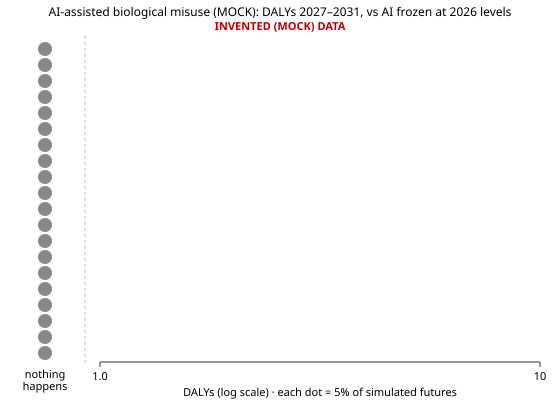

> ⚠️ **INVENTED NUMBERS: THIS CARD USES MOCK DATA.** It shows the format only. Do not quote any figure.

<!-- GENERATED by `aiwelfare build card bio-misuse`. Do not edit: change mock/cards/bio-misuse.md, the model or the claims, then rebuild. -->

# AI-assisted biological misuse (MOCK)

**In one line:** MOCK: AI models help someone cause a disease outbreak they couldn't otherwise have caused.

| | |
|---|---|
| **Expected harm, 2027–2031** | **~160k DALYs** (90% range: 0 → 0) |
| **Magnitude** | order of 10^5 DALYs · 0.00058× malaria (MOCK value) · 0.00046× road injuries (MOCK value) |
| **Confidence** | 🔺 **Low**. Tail-dominated: the top 5% of futures give 100% of the expected value |
| **Mainly comes from** | Open-weight models (54%) · API-served frontier models (37%) · Frontier models run locally / on-premises (9%) |
| **Compared with** | AI frozen at 2026 levels |

```
aiwelfare show risk/bio-misuse --counterfactual no-ai --include-mock      # same card, different comparison
aiwelfare show risk/bio-misuse --counterfactual open-only --include-mock  # same card, different comparison
```

---

## Is this big?

MOCK prose. Probably not in most worlds, but possibly very big in a few: the expected value is
driven by a small chance of a very large outbreak.

In the model, the median future has **0 DALYs** over 2027–2031, and 90% of simulated futures fall between 0 and 0. In 99% of futures nothing happens.



```
aiwelfare dist risk/bio-misuse --include-mock                      # quantile dotplot + percentiles in the terminal
aiwelfare compare risk/bio-misuse baseline/malaria --include-mock  # side by side, same window and units
```

## Why it might be much bigger, or much smaller

The parameters below move the estimate most when each moves alone from its 5th to its 95th percentile.

| If you believe… | …the estimate moves |
|---|---|
| A **pandemic-scale** outcome is plausible within five years | ⬆ ×3.2 |
| Outcomes are capped at a **local** epidemic | ⬇ ×3.7e-05 |
| The **expert forecast** estimate is the right one | ⬆ ×1.8 |
| The **lab evaluation** estimate is the right one | ⬇ ×0.42 |
| P(outbreak), expert-forecast variant is at the **high** end (0.040) | ⬆ ×1.4 |
| P(outbreak), expert-forecast variant is at the **low** end (0.0040) | ⬇ ×0.44 |

**Ranking against** *data-centre-air-pollution*: currently bio-misuse is ×3.8 larger. A single parameter at its extreme can flip this: `severity` (bio-misuse) at 900.

```
aiwelfare cruxes risk/bio-misuse --include-mock                               # full sensitivity analysis (all parameters)
aiwelfare whatif risk/bio-misuse --set severity=VALUE --include-mock          # rerun with your own assumption
aiwelfare flip risk/bio-misuse risk/data-centre-air-pollution --include-mock  # what must change for the ranking to flip
aiwelfare claims risk/bio-misuse --param severity --include-mock              # every sourced claim behind the top crux
```

## Which AI does it come from?

MOCK prose. Open-weight models cannot be withdrawn once released and their safeguards can be
removed; API models can be monitored.

| Deployment | Share of expected value | 90% range of share |
|---|---|---|
| Open-weight models | 54% | 41% – 68% |
| API-served frontier models | 37% | 21% – 50% |
| Frontier models run locally / on-premises | 9% | 6% – 14% |

```
aiwelfare breakdown risk/bio-misuse --by access-mode --include-mock  # shares with intervals
aiwelfare claims risk/bio-misuse --tag access-mode --include-mock    # the evidence behind each row
```

## What kinds of work target this risk?

*This section describes the work; it does not rate how much each kind helps (tractability is out of scope, see VISION.md).*

| Kind of work | Close to ML engineering? | Where it's done | Sources |
|---|---|---|---|
| Dangerous-capability evaluations | ✅ Very | AI labs, government AI security institutes, independent evaluators | `mock-aisi-evaluation-2026` (MOCK 6) |
| Misuse classifiers and monitoring for API models | ✅ Very | AI labs | `mock-lab-system-card-2026` (MOCK 5) |
| Safeguards that survive fine-tuning (for open-weight models) | ✅ Very | Research labs, academia | *no source linked yet* |
| DNA-synthesis screening and other biosecurity | ➖ Partly | Biosecurity organisations, governments | *no source linked yet* |

```
aiwelfare work risk/bio-misuse --refs --include-mock                             # each kind of work + the sources linking it
aiwelfare refs risk/bio-misuse --work dangerous-capability-evals --include-mock  # sources for one kind of work only
aiwelfare work --kind dangerous-capability-evals --include-mock                  # every risk this kind of work targets
```

## What this number leaves out

Economic and social disruption beyond health loss · Loss of trust in science and public health · Anything after 2031.

```
aiwelfare not-captured risk/bio-misuse --refs --include-mock  # each excluded harm + the sources that discuss it
```

---

<details>
<summary><b>For checking: model, evidence and provenance</b></summary>

### All three comparisons

| Compared with… | Median | 90% interval | Expected value |
|---|---|---|---|
| No modern AI | 0 | 0 – 0 | 250k |
| AI frozen at 2026 levels | 0 | 0 – 0 | 160k |
| Only open-weight / older models advance | 0 | 0 – 0 | 79k |

### Model

`mock/models/bio_misuse.py`. Parameters, with the 90% interval of each as simulated:

| Parameter | What it is | Value | Evidence basis | Claims |
|---|---|---|---|---|
| `evidence` | Which evidence type sets the outbreak probability in this future | expert forecast · lab evaluation · independent evaluation (equal weight) | measured | 001, 002, 003 |
| `p_forecast` | P(outbreak), expert-forecast variant | 0.0040 – 0.040 | expert-judgement | 001 |
| `p_lab` | P(outbreak), lab-evaluation variant | 0.0010 – 0.010 | measured | 002 |
| `p_independent` | P(outbreak), independent-evaluation variant | 0.0020 – 0.020 | measured | 003 |
| `severity` | DALYs if an outbreak happens | 1.0k – 78M | modelled | 005 |
| `post_2026_share` | Share of the risk from capabilities after 2026 | 0.52 – 0.83 | expert-judgement | 006 |
| `open_only_share` | Share that remains if only open-weight models advance | 0.21 – 0.44 | expert-judgement | 007 |
| `share_open_weight` | Share of the risk via open-weight models | 0.41 – 0.68 | expert-judgement | 008 |
| `share_local_frontier` | Share via locally-run frontier models | 0.055 – 0.14 | speculation | 009 |

### Evidence, by type

| Evidence type | Basis | Sources | Claims |
|---|---|---|---|
| assumption | speculation | — | 1 |
| epidemiological-model | modelled | `mock-outbreak-model-2025` | 1 |
| expert-forecast | expert-judgement | `mock-expert-survey-2026` | 4 |
| independent-evaluation | measured | `mock-aisi-evaluation-2026` | 1 |
| lab-evaluation | measured | `mock-lab-system-card-2026` | 1 |

Results by source, where several estimate the same quantity (D14):

| Parameter | Variant | Median | 90% interval | Expected value |
|---|---|---|---|---|
| `evidence` | expert forecast | 0 | 0 – 0 | 460k |
| `evidence` | lab evaluation | 0 | 0 – 0 | 43k |
| `evidence` | independent evaluation | 0 | 0 – 0 | 120k |

The combined figures weight each variant equally (D14).

### ⚠️ Assumptions (no source gives these values)

- **bio-misuse-009**:  *Would be replaced by:* MOCK: a survey of on-premises frontier deployments.

### Confidence (D12)

Low. Top 5% of futures give 100% of the expected value (tail-dominated above 50%, D11). Share of crux swing from parameters backed by measured evidence: 17%; from expert judgement or speculation only: 10%.

### Known limitations

- MOCK. Every input is invented; this card shows the format only.

### Index and provenance

MIT AI Risk Repository mapping not done yet (D3) · model `mock/models/bio_misuse.py` · prose `mock/cards/bio-misuse.md` · inputs as of commit `e7b7a0a` · seed 20261125, 100,000 draws

### Changelog

| Date | Change | Why |
|---|---|---|
| 2026-11-27 | Milestone 1 (part 2): air-pollution model, card builder, full CLI, mock bio-misuse | Finishes the work interrupted on 2026-11-25. The air-pollution model now declares its fixed inputs (2023 electricity, AI-share estimates) as parameters instead  |

```
aiwelfare model risk/bio-misuse --include-mock                              # print the model and its parameters
aiwelfare claims risk/bio-misuse --evidence-type assumption --include-mock  # the flagged assumptions
aiwelfare sources risk/bio-misuse --include-mock                            # full bibliography, with pinned versions
aiwelfare rerun risk/bio-misuse --include-mock                              # reproduce every number on this card
aiwelfare log risk/bio-misuse --include-mock                                # full change history with reasons
```

</details>

> ⚠️ **INVENTED NUMBERS: THIS CARD USES MOCK DATA.**
