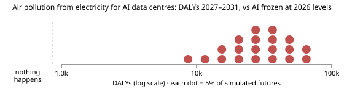

<!-- GENERATED by `aiwelfare build card data-centre-air-pollution`. Do not edit: change cards/data-centre-air-pollution.md, the model or the claims, then rebuild. -->

# Air pollution from electricity for AI data centres

**In one line:** Power plants and backup generators that supply AI data centres emit fine particles and ozone precursors, which cause premature deaths downwind.

*Scope: Contiguous United States only. The three health studies cover all data centres; the AI share is attributed by the model.*

| | |
|---|---|
| **Expected harm, 2027–2031** | **~33k DALYs** (90% range: 12k → 66k) |
| **Magnitude** | order of 10^4 DALYs · no sourced baselines yet |
| **Confidence** | 🔸 **Medium**. Not tail-dominated (top 5% of futures give 11% of the expected value) |
| **Mainly comes from** | not modelled yet |
| **Compared with** | AI frozen at 2026 levels |

```
aiwelfare show risk/data-centre-air-pollution --counterfactual no-ai  # same card, different comparison
```

---

## Is this big?

The harm is spread over many people downwind of power plants, a little at a time, rather than
coming from rare events. Most of the uncertainty is about how fast data-centre electricity
grows and how many years of life each death costs, not about whether harm happens at all.

In the model, the median future has **30k DALYs** over 2027–2031, and 90% of simulated futures fall between 12k and 66k. That is about **2.9k premature deaths** in expectation (1.1k → 5.4k).



```
aiwelfare dist risk/data-centre-air-pollution  # quantile dotplot + percentiles in the terminal
```

## Why it might be much bigger, or much smaller

The parameters below move the estimate most when each moves alone from its 5th to its 95th percentile.

| If you believe… | …the estimate moves |
|---|---|
| US data-centre electricity reaches the **top** of LBNL's 2028 scenario range | ⬆ ×1.6 |
| US data-centre electricity stays at the **bottom** of LBNL's 2028 range | ⬇ ×0.47 |
| Each air-pollution death costs **many** years of healthy life | ⬆ ×1.3 |
| These deaths fall mostly on the **very old**, costing few years each | ⬇ ×0.72 |
| The **GEOS-Chem (Chen et al.)** estimate is the right one | ⬆ ×1.2 |
| The **COBRA (Han et al.)** estimate is the right one | ⬇ ×0.76 |

**Ranking:** no neighbouring risk has a real estimate yet, so there is no ranking to flip.

```
aiwelfare cruxes risk/data-centre-air-pollution                    # full sensitivity analysis (all parameters)
aiwelfare whatif risk/data-centre-air-pollution --set e2028=VALUE  # rerun with your own assumption
aiwelfare claims risk/data-centre-air-pollution --param e2028      # every sourced claim behind the top crux
```

## Which AI does it come from?

Electricity use is not yet split by how models are accessed. Training and serving of large
models run in large data centres whichever way their weights are distributed.

*Breakdown not modelled yet:* No source read yet splits AI data-centre electricity by access mode (open-weight, API frontier, locally-run frontier).

```
aiwelfare breakdown risk/data-centre-air-pollution --by access-mode  # shares with intervals
aiwelfare claims risk/data-centre-air-pollution --tag access-mode    # the evidence behind each row
```

## What kinds of work target this risk?

*This section describes the work; it does not rate how much each kind helps (tractability is out of scope, see VISION.md).*

| Kind of work | Close to ML engineering? | Where it's done | Sources |
|---|---|---|---|
| More energy-efficient training and inference (hardware, models, serving) | ✅ Very | AI labs, chip makers, academia | *no source linked yet* |
| Shifting AI workloads in time to cleaner hours | ✅ Yes | AI labs and cloud providers (scheduling and serving teams) | `han-2026-health-informed-computing` (p. 10) |
| Health-informed siting of data centres and shifting load between regions | ➖ Partly | Cloud providers, academia (computing systems), grid operators | `han-2026-health-informed-computing` (p. 10, p. 2) |
| Clean-energy procurement for data centres | ❌ No | Cloud providers, utilities | `han-2026-health-informed-computing` (p. 10) |
| Cleaner backup generation (newer-tier diesel, alternatives to diesel) | ❌ No | Data-centre operators, state air regulators | `han-2026-health-informed-computing` (p. 10, p. 4) |
| Reporting air pollutants and health impacts alongside energy use | ❌ No | AI companies' sustainability teams, regulators | `han-2026-health-informed-computing` (p. 10) |

```
aiwelfare work risk/data-centre-air-pollution --refs                      # each kind of work + the sources linking it
aiwelfare refs risk/data-centre-air-pollution --work energy-efficient-ml  # sources for one kind of work only
aiwelfare work --kind energy-efficient-ml                                 # every risk this kind of work targets
```

## What this number leaves out

Climate damage from the same electricity's greenhouse-gas emissions · Asthma symptoms and other illness, which the DALY conversion treats as small · Local exposure near facilities, and who bears it · Data centres outside the United States · Anything after 2031.

```
aiwelfare not-captured risk/data-centre-air-pollution --refs  # each excluded harm + the sources that discuss it
```

---

<details>
<summary><b>For checking: model, evidence and provenance</b></summary>

### All three comparisons

| Compared with… | Median | 90% interval | Expected value |
|---|---|---|---|
| No modern AI | 55k | 25k – 110k | 60k |
| AI frozen at 2026 levels | 30k | 12k – 66k | 33k |
| Only open-weight / older models advance | *not modelled* | | Needs the share of AI electricity driven by frontier versus open-weight or older models; no source read yet. |

### Model

`models/data_centre_air_pollution.py`. Parameters, with the 90% interval of each as simulated:

| Parameter | What it is | Value | Evidence basis | Claims |
|---|---|---|---|---|
| `study` | Which study's deaths-per-TWh estimate this future uses | COBRA (Han et al.) · GEOS-Chem (Chen et al.) · AP4 (Muller) (equal weight) | modelled | 001, 009, 014 |
| `rate_cobra` | Deaths per TWh, COBRA (Han et al.), incl. backup generators | 1.9 – 3.0 | modelled | 001, 002, 008 |
| `rate_geoschem` | Deaths per TWh, GEOS-Chem (Chen et al.), grid only | 3.3 – 4.2 | modelled | 009, 010 |
| `rate_ap4` | Deaths per TWh, AP4 (Muller), grid only | 1.9 – 4.1 | modelled | 013, 014, 015, 016, 017 |
| `rate_backup` | Deaths per TWh from backup generators (added to grid-only studies) | 0.15 – 0.21 | modelled | 007 |
| `e2028` | Total US data-centre electricity in 2028 (TWh) | 340 – 570 | modelled | 020 |
| `post_2028_growth_ratio` | Growth after 2028 as a fraction of 2023–28 growth | 0.52 – 0.97 | expert-judgement | 027 |
| `ai_share_source` | Which estimate of AI's share of 2023 electricity this future uses | LBNL server data (Shehabi et al.) · IEA via Muller (equal weight) | modelled | 018, 021, 022 |
| `conventional_growth` | Annual growth of non-AI data-centre electricity | 0.0040 – 0.076 | modelled | 028, 023 |
| `grid_trend_2031` | Deaths per TWh in 2031 relative to the study year | 0.72 – 0.98 | expert-judgement | 026 |
| `dalys_per_death` | DALYs per premature death | 8.3 – 15 | speculation | 025 |
| `e2023` | Total US data-centre electricity in 2023 (TWh) | 180 | modelled | 019 |
| `ai_share_lbnl` | AI share of 2023 data-centre electricity, LBNL variant | 0.40 | modelled | 021, 022 |
| `ai_share_iea` | AI share of 2023 data-centre electricity, IEA variant | 0.15 | modelled | 018 |

### Evidence, by type

| Evidence type | Basis | Sources | Claims |
|---|---|---|---|
| assumption | expert-judgement, speculation | — | 4 |
| energy-model | modelled | `chen-2026-data-center-air-quality`, `han-2026-health-informed-computing`, `muller-2026-data-center-damages`, `shehabi-2024-us-data-center-energy` | 12 |
| epidemiological-model | modelled | `chen-2026-data-center-air-quality`, `han-2026-health-informed-computing`, `muller-2026-data-center-damages` | 10 |

Results by source, where several estimate the same quantity (D14):

| Parameter | Variant | Median | 90% interval | Expected value |
|---|---|---|---|---|
| `study` | COBRA (Han et al.) | 23k | 9.8k – 47k | 25k |
| `study` | GEOS-Chem (Chen et al.) | 38k | 16k – 74k | 41k |
| `study` | AP4 (Muller) | 30k | 12k – 65k | 33k |
| `ai_share_source` | LBNL server data (Shehabi et al.) | 30k | 12k – 66k | 34k |
| `ai_share_source` | IEA via Muller | 29k | 11k – 65k | 32k |

The combined figures weight each variant equally (D14).

### ⚠️ Assumptions (no source gives these values)

- **data-centre-air-pollution-025**: DALYs lost per premature death attributable to data-centre air pollution in the US. *Would be replaced by:* GBD 2023 (IHME): ratio of US DALYs to deaths attributable to ambient PM2.5 and ozone, by year.
- **data-centre-air-pollution-026**: Deaths per TWh in 2027–2031 relative to the study year (grid change). *Would be replaced by:* A projection of US power-sector air-pollution mortality per TWh to 2031 (e.g. EPA or EIA scenarios run through a health model).
- **data-centre-air-pollution-027**: Growth of US data-centre electricity after 2028, as a fraction of the 2023–2028 scenario growth rate. *Would be replaced by:* A US data-centre electricity projection to 2030 or later (e.g. EPRI, IEA, or a later LBNL report).
- **data-centre-air-pollution-028**: Annual growth of non-AI data-centre electricity after 2023. *Would be replaced by:* LBNL's 2028 breakdown by server type (Figure 5.1 data) or a later report.

### Confidence (D12)

Medium. Top 5% of futures give 11% of the expected value (tail-dominated above 50%, D11). Share of crux swing from parameters backed by measured evidence: 0%; from expert judgement or speculation only: 32%.

### Known limitations

- US only; no source read yet gives a global estimate.
- None of the three health studies is AI-specific; AI's share of data-centre electricity is attributed in the model, from two estimates that disagree.
- The conversion from deaths to DALYs is a placeholder assumption until a GBD-derived source is added.
- No source projects US data-centre electricity beyond 2028; 2029–2031 extrapolates under an assumption.
- The GEOS-Chem interval covers concentration-response uncertainty only.

### Index and provenance

MIT AI Risk Repository mapping not done yet (D3) · model `models/data_centre_air_pollution.py` · prose `cards/data-centre-air-pollution.md` · inputs as of commit `e7b7a0a` · seed 20261125, 100,000 draws

### Changelog

| Date | Change | Why |
|---|---|---|
| 2026-11-27 | Milestone 1 (part 2): air-pollution model, card builder, full CLI, mock bio-misuse | Finishes the work interrupted on 2026-11-25. The air-pollution model now declares its fixed inputs (2023 electricity, AI-share estimates) as parameters instead  |
| 2026-11-27 | Milestone 1 (part 1): schemas, CLI scaffold, data-centre air-pollution sources and claims | Records decisions D11-D15 (approved by the maintainer) and the source-integration procedure. Air pollution is the first card built from real evidence: three ind |

```
aiwelfare model risk/data-centre-air-pollution                              # print the model and its parameters
aiwelfare claims risk/data-centre-air-pollution --evidence-type assumption  # the flagged assumptions
aiwelfare sources risk/data-centre-air-pollution                            # full bibliography, with pinned versions
aiwelfare rerun risk/data-centre-air-pollution                              # reproduce every number on this card
aiwelfare log risk/data-centre-air-pollution                                # full change history with reasons
```

</details>
